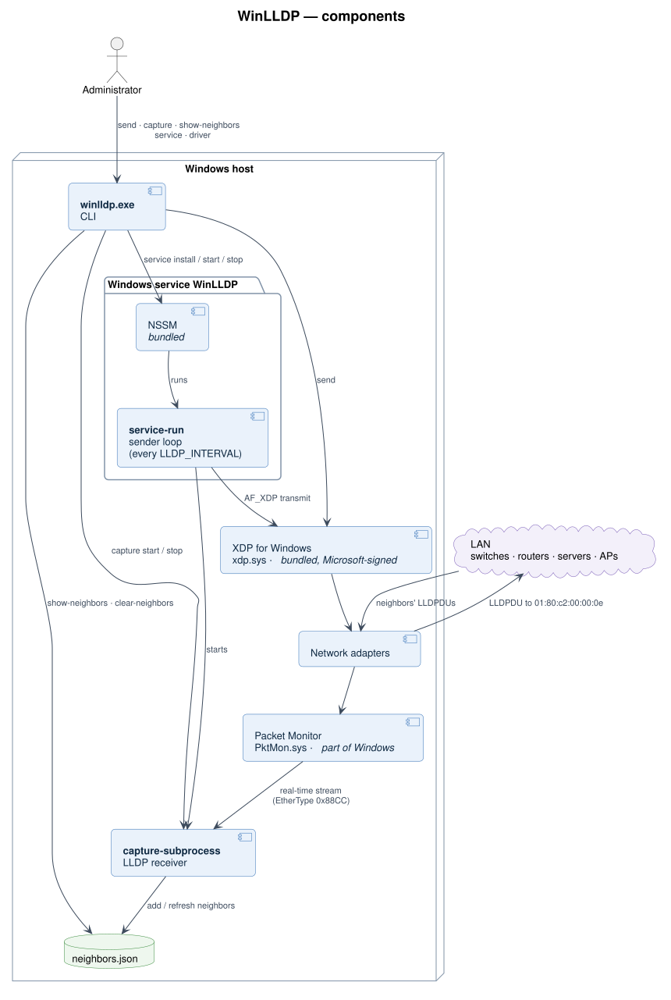
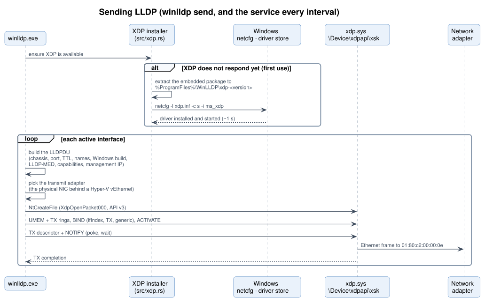
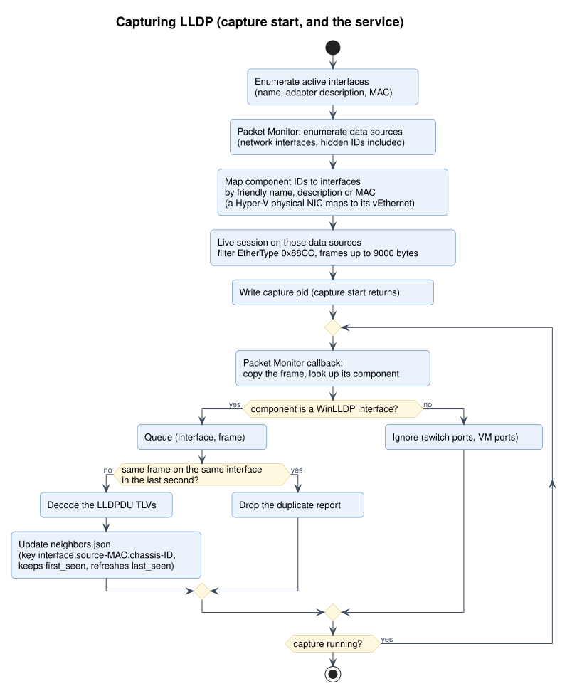
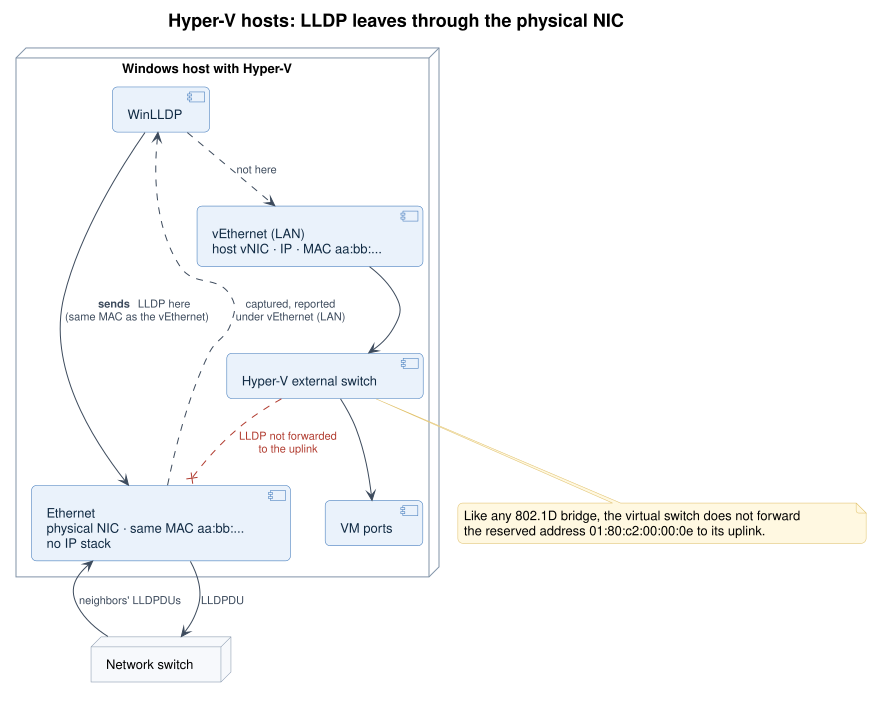
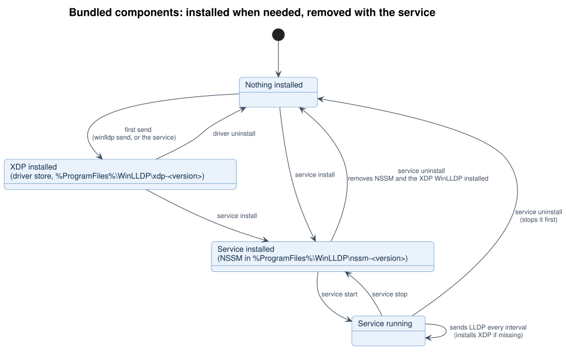

<div align="center">

# WinLLDP

**LLDP for Windows — announce your machines to the network and discover what they are plugged into.**

[](https://github.com/oriolrius/WinLLDP/actions/workflows/ci.yml)
[](https://github.com/oriolrius/WinLLDP/releases/latest)
[](#requirements)
[](rust-toolchain.toml)
[](LICENSE)

</div>

WinLLDP is a single, self-contained executable that implements the **Link Layer Discovery
Protocol** (IEEE 802.1AB) on Windows. It advertises the host — name, Windows version and build,
management address, LLDP-MED inventory — to switches and network management systems, and records
the LLDP neighbors it hears on every interface. It runs from the command line or as a Windows
service, and needs nothing else installed: the components it relies on are embedded and set up
automatically.

## Contents

- [Features](#features)
- [Requirements](#requirements)
- [Quick start](#quick-start)
- [Running as a Windows service](#running-as-a-windows-service)
- [Command reference](#command-reference)
- [Configuration](#configuration)
- [What WinLLDP advertises](#what-winlldp-advertises)
- [Discovered neighbors](#discovered-neighbors)
- [How it works](#how-it-works)
- [Files and locations](#files-and-locations)
- [Security](#security)
- [Troubleshooting](#troubleshooting)
- [Building from source](#building-from-source)
- [Third-party components and license](#third-party-components-and-license)

## Features

- **Announces the host** on every active interface: chassis and port (MAC), system name, the exact
  Windows version and build, port description, management IPv4/IPv6 address and ifIndex, system
  capabilities and LLDP-MED inventory (hardware, firmware and software revision, model name).
- **Discovers neighbors** — switches, routers, access points, servers, hypervisors — and keeps them
  in `neighbors.json`, with a live table view (`show-neighbors --watch`).
- **Nothing to install.** Sending uses Microsoft's [XDP for Windows](https://github.com/microsoft/xdp-for-windows)
  driver and the service runs under [NSSM](https://nssm.cc/); both are embedded in `winlldp.exe`,
  installed on first use and removed with the service. Capturing uses Windows' built-in Packet
  Monitor.
- **Hyper-V aware.** On hosts whose `vEthernet` adapters sit on an external virtual switch, LLDP
  is sent on the physical adapter behind the switch, so it actually reaches the network, and
  neighbors are still reported under the `vEthernet` name.
- **Windows service** with automatic start and clean stop, managed with `winlldp service`.
- **Small and fast**: one ~2 MB native executable (Rust), no runtime, starts instantly.
- **Scriptable**: plain-text output, `.env` or environment configuration, exit code `1` on failure.

## Requirements

| | |
|---|---|
| Operating system | Windows 11 or Windows Server 2019 or later, x64 |
| Discovering neighbors (`capture`) | Windows 11 24H2 or later, or Windows Server 2025 or later (Packet Monitor API) |
| Privileges | Administrator (raw Ethernet frames, driver and service installation) |
| Anything else | Nothing — see [Third-party components](#third-party-components-and-license) |

## Quick start

1. Download `winlldp-<version>-windows-x64.zip` (or the bare `.exe`) from the
   [latest release](https://github.com/oriolrius/WinLLDP/releases/latest) and unpack it in a folder
   such as `C:\Tools\WinLLDP\`. `SHA256SUMS.txt` lists the checksums of the release files.
2. Open **PowerShell as Administrator** in that folder.
3. Announce this machine and look at the network:

```powershell
.\winlldp.exe send -v                # announce this machine now (prints the packet it sends)
.\winlldp.exe capture start          # start listening for neighbors in the background
.\winlldp.exe show-neighbors --watch # live table, refreshed every 5 seconds (Ctrl+C to exit)
```

The first `send` installs the network driver it needs; it takes about a second and happens once.

## Running as a Windows service

The service announces the machine every `LLDP_INTERVAL` seconds and keeps the neighbor table up
to date, starting automatically with Windows.

```powershell
.\winlldp.exe service install    # register the "WinLLDP" service (automatic start)
.\winlldp.exe service start
.\winlldp.exe service status     # add -v for the full service configuration and log tail
```

`service stop`, `service restart` and `service uninstall` complete the set; uninstalling also
removes the components WinLLDP installed. Keep `winlldp.exe` where it is while the service exists:
the service runs it from that folder, and its files live next to it.

## Command reference

All commands accept `-h/--help`. Commands that read the configuration accept
`-e/--env-file <path>`, and most accept `-v/--verbose` for debug output.

| Command | Description |
|---|---|
| `send [-i <interface>] [-v]` | Send the LLDPDU now on every active interface, or on one (`-i`); `-v` prints the decoded packet and its bytes |
| `capture start` | Start the background capture process (returns once it is capturing) |
| `capture stop` | Stop it |
| `capture status` | PID, uptime, memory and CPU of the capture process |
| `capture log [-n <lines>]` | Show the capture log (last 20 lines; `-n 0` for all) |
| `show-neighbors [-w]` | Table of discovered neighbors; `--watch` refreshes every 5 s |
| `clear-neighbors` | Empty the neighbor table |
| `show-interfaces` | Network interfaces with MAC address, state and IPv4 addresses |
| `show-config` | Effective configuration |
| `debug-paths` | Where the configuration and data files are, and whether they exist |
| `service install` · `uninstall` · `start` · `stop` · `restart` · `status` | Manage the Windows service |
| `driver status` · `install` · `uninstall` | Inspect or manage the bundled network driver (normally automatic) |
| `version` | Show the version |

Exit codes: `0` success, `1` failure (with a message on stderr), `2` invalid command line.

## Configuration

Settings come from environment variables, then from a `.env` file, then from the defaults. The
`.env` file is the one given with `--env-file`, or the first `.env` found in the working directory
or its parents; the service runs in the executable's folder, so put it next to `winlldp.exe`.
The release includes an annotated [`env.example`](env.example).

| Variable | Default | Description |
|---|---|---|
| `LLDP_INTERVAL` | `30` | Seconds between announcements (service). Minimum `5`. |
| `LLDP_TTL` | `120` | Seconds neighbors should keep this host. At least `LLDP_INTERVAL`, at most `65535`; 3–4× the interval is typical. |
| `LLDP_INTERFACE` | `all` | `all` active interfaces, or one interface name as shown by `show-interfaces`. |
| `LLDP_SYSTEM_NAME` | `auto` | System Name TLV; `auto` uses the computer's host name. |
| `LLDP_PORT_DESCRIPTION` | `Ethernet Port` | Port Description TLV; empty uses the interface name. |
| `LLDP_MANAGEMENT_ADDRESS` | `auto` | IPv4 or IPv6 address to advertise; `auto` uses the interface's first IPv4 address, else the host's primary address. |
| `LLDP_NEIGHBORS_FILE` | `neighbors.json` | Absolute path for the neighbor table; otherwise it is kept next to the executable. |
| `LLDP_SYSTEM_DESCRIPTION` | — | Reserved: the System Description TLV always carries the Windows version and build. |

```env
# .env next to winlldp.exe
LLDP_INTERVAL=30
LLDP_TTL=120
LLDP_INTERFACE=all
LLDP_SYSTEM_NAME=FileServer01
LLDP_PORT_DESCRIPTION=Uplink to core switch
LLDP_MANAGEMENT_ADDRESS=auto
```

Values may contain spaces without quotes; single and double quotes, `# comments`,
`export KEY=value` and `${VARIABLE}` / `${VARIABLE:-default}` expansion are supported.

## What WinLLDP advertises

One LLDPDU per interface, to the nearest-bridge address `01:80:c2:00:00:0e` (EtherType `0x88CC`):

| TLV | Content | Example |
|---|---|---|
| Chassis ID | MAC address of the interface (subtype 4) | `50:eb:f6:2c:f2:ba` |
| Port ID | MAC address of the interface (subtype 3) | `50:eb:f6:2c:f2:ba` |
| Time To Live | `LLDP_TTL` | `120` |
| Port Description | `LLDP_PORT_DESCRIPTION` | `Ethernet Port` |
| System Name | Host name or `LLDP_SYSTEM_NAME` | `FILESERVER01` |
| System Description | Windows version, build and architecture | `Windows 10.0.26100 AMD64` |
| System Capabilities | Station only (supported and enabled) | `0x0080` |
| Management Address | IPv4 or IPv6 address, with the interface's ifIndex | `10.2.0.47`, ifIndex 11 |
| LLDP-MED Capabilities | Endpoint Class III | capabilities `0x0001`, class 3 |
| LLDP-MED Hardware Revision | Processor architecture | `AMD64` |
| LLDP-MED Firmware Revision | Windows version and build | `10.0.26100` |
| LLDP-MED Software Revision | WinLLDP version | `WinLLDP 2.0.0` |
| LLDP-MED Model Name | Windows edition | `Microsoft Windows 11 Pro` |

Switches show these as the neighbor's name, platform, version and management IP — for example
MikroTik's `/ip neighbor`, Cisco's `show lldp neighbors detail` or a UniFi controller.

## Discovered neighbors

```text
> .\winlldp.exe show-neighbors
LLDP Neighbors:
+------------+-------------------+-------------+-----------------+--------+-------+-----------------+
| Interface  | Neighbor          | System Name | Port            | Age    | TTL   | Management IP   |
+============+===================+=============+=================+========+=======+=================+
| Ethernet   | d4:ca:6d:fa:a5:26 | core-sw01   | bridge/ether20  | 3m 12s | 120s  | 10.2.99.2       |
+------------+-------------------+-------------+-----------------+--------+-------+-----------------+
| Ethernet   | 58:47:ca:79:73:a2 | pve01       | enp87s0         | 2m 40s | 120s  | 10.2.0.2        |
+------------+-------------------+-------------+-----------------+--------+-------+-----------------+

Total neighbors: 2
```

Each neighbor is stored in `neighbors.json` under `interface:source-MAC:chassis-ID`:

```json
{
  "Ethernet:d4:ca:6d:fa:a5:39:d4:ca:6d:fa:a5:26": {
    "interface": "Ethernet",
    "source_mac": "d4:ca:6d:fa:a5:39",
    "data": {
      "chassis_id": "d4:ca:6d:fa:a5:26",
      "chassis_id_subtype": "MAC_ADDRESS",
      "port_id": "bridge/ether20",
      "port_id_subtype": "INTERFACE_NAME",
      "ttl": 120,
      "system_name": "core-sw01",
      "system_description": "MikroTik RouterOS 6.49.7 (stable) CRS125-24G-1S-2HnD",
      "management_addresses": ["10.2.99.2"],
      "management_address": "10.2.99.2"
    },
    "first_seen": "2026-10-22T19:08:05.713838",
    "last_seen": "2026-10-22T19:11:17.221904",
    "ttl": 120
  }
}
```

`management_address` is the first IPv4 address the neighbor advertises (or its first address);
all of them are in `management_addresses`.

## How it works

### Components

`winlldp.exe` is the command-line tool, the service process (run by the bundled NSSM) and the
capture process. Frames leave through XDP for Windows and are captured through Packet Monitor.



### Sending

On first use WinLLDP installs the embedded, Microsoft-signed XDP driver package. Each
announcement builds the LLDPDU of the interface, chooses the adapter that puts it on the wire and
transmits it through an AF_XDP socket (XDP API v3, generic mode).



### Capturing

The capture process opens a Packet Monitor session filtered on EtherType `0x88CC`, maps every
reporting component to a WinLLDP interface, drops the duplicate reports of a frame that crosses
several components, and updates `neighbors.json`.



### Hyper-V hosts

A Hyper-V external virtual switch behaves like an 802.1D bridge and does not forward LLDP's
reserved address to its uplink, so an LLDPDU sent on a `vEthernet` adapter never reaches the
physical network. WinLLDP sends on the physical adapter that shares the `vEthernet` MAC address,
and reports what it receives there under the `vEthernet` name.



### Bundled components



Diagram sources are in [`docs/diagrams/`](docs/diagrams) (PlantUML; `just diagrams` renders them).
Design decisions are recorded in [`docs/decisions/`](docs/decisions).

## Files and locations

| Location | File | Content |
|---|---|---|
| Next to `winlldp.exe` | `neighbors.json` | Discovered neighbors (unless `LLDP_NEIGHBORS_FILE` is absolute) |
| | `capture.pid` | PID of the running capture process |
| | `winlldp_capture.log` | Capture process log (`capture log`) |
| | `nssm_service.log` | Service log |
| | `winlldp_service.log` | Application log |
| | `.env` | Optional configuration |
| `%ProgramFiles%\WinLLDP\` | `xdp-<version>\` | XDP for Windows driver package (installed into Windows' driver store) |
| | `nssm-<version>\nssm.exe` | Service host |
| | `installed-by-winlldp` | Marks the driver as installed by WinLLDP |

## Security

- WinLLDP needs administrator rights to send and capture raw frames and to install its driver and
  service. The service runs as LocalSystem.
- The components the service runs as SYSTEM are written to `%ProgramFiles%\WinLLDP`, which only
  administrators can modify. When running the service, keep `winlldp.exe` itself in a folder that
  standard users cannot write to as well.
- The XDP driver is signed by Microsoft (Windows Hardware Compatibility Publisher) and installed
  unmodified; the embedded files are listed with their SHA-256 sums in [`vendor/`](vendor).
  WinLLDP only removes a driver it installed itself.
- `capture stop` only terminates the process recorded in `capture.pid` if it is still a WinLLDP
  process.
- Received LLDPDUs are parsed defensively: malformed or unknown TLVs never stop the capture.

## Troubleshooting

| Symptom | What to do |
|---|---|
| `Capturing LLDP needs the Windows Packet Monitor API` | Capturing needs Windows 11 24H2+ or Windows Server 2025+. Sending works on earlier versions. |
| `Installing the XDP driver needs administrator rights` | Run WinLLDP once as administrator; the service always has the rights it needs. |
| No neighbors appear | Check that the switch port has LLDP enabled (switches send every 30–60 s), that the interface is up (`show-interfaces`) and that the capture runs (`capture status`, `capture log`). |
| The switch does not list this host | Run `send -v` and check the `Transmit adapter` and `Sent successfully` lines; on Hyper-V hosts the frame leaves through the physical adapter. |
| The service does not start | `service status -v` shows its configuration and last log lines, `nssm_service.log` is next to the executable, and `driver status` shows the components. |

## Building from source

Rust is pinned in [`rust-toolchain.toml`](rust-toolchain.toml) and the tasks are in the
[`Justfile`](Justfile):

```bash
just build      # release build → dist/winlldp.exe
just lint       # cargo fmt --check, clippy -D warnings
just test       # unit and integration tests, then the driver/service lifecycle tests
just diagrams   # render docs/diagrams/*.puml with the PlantUML API server
```

It builds natively on Windows (MSVC) or cross-compiles from WSL/Linux (`x86_64-pc-windows-gnu`,
mingw-w64), where the tests run through WSL interop. The integration tests run the real
executable and need administrator rights. The [development guide](docs/development.md) describes
the code layout, and the [workflows](.github/workflows/README.md) CI and releases.

Releases follow [Conventional Commits](https://www.conventionalcommits.org/) and are cut with
[commitizen](https://commitizen-tools.github.io/commitizen/): `uvx --from commitizen cz bump`
updates the version and [`CHANGELOG.md`](CHANGELOG.md) and tags it; pushing the tag builds, tests
and publishes the release.

## Third-party components and license

`winlldp.exe` embeds, unmodified:

- [XDP for Windows](https://github.com/microsoft/xdp-for-windows) 1.4.0 — Microsoft, MIT license
- [NSSM](https://nssm.cc/) 2.24-101-g897c7ad — public domain

Details and license texts: [`THIRD-PARTY-NOTICES.md`](THIRD-PARTY-NOTICES.md).

WinLLDP is released under the [MIT License](LICENSE).
